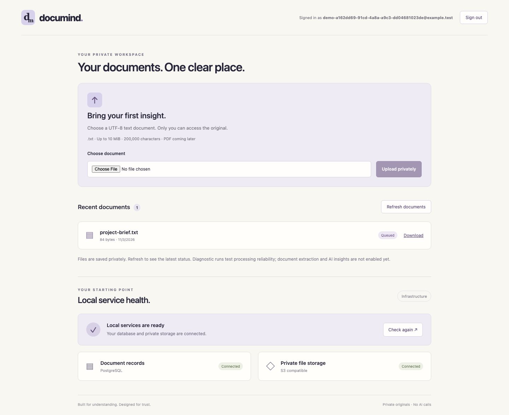

# DocuMind

A document-processing application demonstrating durable jobs, worker recovery and schema-validated AI extraction.

**Status:** DM-02 adds recoverable job claims, expiring leases, bounded retries and fenced result persistence on the DM-01 private-upload foundation. Register/sign in, upload UTF-8 text, list and download your own originals. A targeted synthetic diagnostic exercises the worker; general extraction, PDF parsing and AI are not enabled yet. No public deployment or paid provider is configured.



## Run locally

Requirements: **Go 1.27.3**, **Node 24.22.1**, Docker with Compose. Versions are recorded in `.go-version`, `.node-version`, `go.mod`/`go.sum` and `package-lock.json`.

```sh
npm ci
go mod download
npm run setup
npm run services:up
npm run db:migrate
```

In separate terminals, from the repository root:

```sh
npm run api
```

```sh
npm run dev
```

Open **http://127.0.0.1:4320** to see the standalone sign-in screen. Choose **New here? Create an account** to register with an email and a password of at least 12 characters. After authentication, the entry screen is replaced by the document application. Reload restores an existing valid session; sign-out returns to the login screen. There are no seeded user credentials. Upload a `.txt` file, up to 10 MiB and 200,000 characters. Ordinary uploads stay **Queued** until a general extraction adapter is implemented in DM-03. Download returns the private original; PDF uploads are explicitly rejected until DM-03. The screen also checks PostgreSQL and private storage. If unavailable, start services/API and use **Check again**. The frontend is a development server; production serving belongs to deployment work.

## Worker diagnostic

`npm run worker:check` validates dependencies without claiming work. `npm run worker` without a diagnostic document ID exits with an explanation because no general extractor is configured.

Upload `tests/fixtures/worker-smoke.txt` through the authenticated UI. In browser developer tools, inspect the successful `POST /api/documents` response and copy its `id` (or find that file in `GET /api/documents`). Then run:

```sh
npm run worker -- --smoke-document <document-id> --once
```

Select **Refresh documents** to see **Diagnostic complete**, with attempt count. The processor reads the real private S3 object but only accepts content starting with `DOCUMIND WORKER SMOKE` followed by a newline. Its persisted result identifies provider `diagnostic`, model `worker-smoke-v1`, and explicitly says no AI extraction occurred. The selected ID limits claims to that document; other queued uploads remain untouched. Selecting an ordinary file explicitly will fail that selected job with `invalid_input`, so use only the supplied synthetic fixture.

To demonstrate automatic retry, upload a fresh copy and run `npm run worker -- --smoke-document <new-id> --smoke-failures 1` without `--once`. The first attempt enters **Retry scheduled**; the next succeeds after 5–6 seconds. Stop the polling worker with Ctrl+C after completion. `--smoke-permanent` injects immediate failure; `--smoke-delay 45s` allows observing **Processing** across heartbeat renewals. Use a fresh upload for each diagnostic; manual retry and result viewing are DM-04 work.

Defaults: 30-second lease, heartbeat every 10 seconds, 60-second hard attempt deadline (55 seconds of processing plus up to 5 seconds to finalize), and three total claims including crashes. Retry delays are 5–6 then 30–36 seconds; Retry-After is capped at 60 seconds. SIGINT/SIGTERM cancels processing and leaves the lease for recovery; restart the same selected worker after expiry. Completion, renewal and failure require the current unexpired claim token. A crash on the final attempt becomes terminal on the next claim scan. No exactly-once execution or billing guarantee is claimed.

## Local services and credentials

| Component | Loopback port | Purpose |
| --- | --- | --- |
| React/Vite | 4320 | Local UI, proxies `/api` to Go |
| Go API | 4321 | Sessions, owner-scoped uploads/downloads and health |
| PostgreSQL 18 | 55433 | Separate bootstrap and restricted runtime roles |
| SeaweedFS 4.51 S3 | 58333 | Private `documind-local` bucket |

Ports are separate from TenantFlow. Compose uses digest-pinned images and persistent volumes; no host-directory mounts are required. Initial storage startup/recovery may take tens of seconds; `services:up` waits for volume registration. Memory limits: 512 MiB PostgreSQL and 768 MiB storage.

Setup generates `.env` with random credentials and restrictive file permissions; rerunning it preserves that file. Keep it with the existing volumes. Do not delete/regenerate credentials to restart services. The application uses bucket-scoped S3 credentials; separate initialization credentials create the bucket and the synthetic readiness object. The storage admin/filer interfaces are not published to the host. This is local HTTP development, not production TLS or a security certification.

`db:migrate` initializes the local runtime role if missing, applies checksum-guarded SQL migrations and initializes the private bucket/readiness object. It is repeatable and does not reset existing passwords. The second migration adds users, hashed sessions, upload intents, documents, jobs and result constraints. Migration 003 adds a hard attempt deadline and lease-state consistency constraints. Existing migration checksums remain unchanged.

Cookies are HttpOnly and SameSite=Lax. Every mutation requires an exact `APP_ORIGIN`, default `http://127.0.0.1:4320`; an optional HTTPS origin enables Secure cookies. Local HTTP origins must be loopback. Do not switch to `localhost` without configuring the matching origin and restarting the API. Passwords use Argon2id. Password recovery, email verification, distributed rate limiting, retention and public quotas remain release work.

Run `npm run uploads:cleanup` to reconcile at most 100 unreferenced upload intents older than one hour. Repeat to drain larger backlogs. Storage/DB failures preserve cleanup candidates; successful document originals are excluded. This command is not a user-document deletion or retention feature.

Stop services without deleting data:

```sh
npm run services:stop
```

After a restart, run `npm run services:up` to wait for health. Do not run `docker compose down -v` unless you explicitly intend to erase this local data.

## Verify

With services running and initialization complete:

```sh
npx playwright install chromium
npm run check
```

Stop the local API and Vite processes first: browser tests own ports 4320/4321. Checks run TypeScript, production web/Go builds, Go tests with the race detector, real PostgreSQL/S3 integration, the worker dependency check and fourteen desktop/mobile browser scenarios. Integration tests use synthetic objects and remove their document/account fixtures. Browser scenarios create synthetic `@example.test` accounts and documents in the local database; they are intentionally not user data and are not a demo login. No real documents are needed. The health error test injects a 503 response. The lost-acknowledgement scenario commits a real upload, replaces its response with 503 and then retries the same key. These are response fault injections, not real network outages.

[Verification and limits](docs/verification.md) · [DM-02 checkpoint](docs/checkpoints/2026-11-03-recoverable-workers.md) · [DM-01 checkpoint](docs/checkpoints/2026-10-31-private-upload.md) · [Bootstrap checkpoint](docs/checkpoints/2026-10-30-bootstrap.md)

## Engineering records

- [Approved MVP specification](specs/001-document-pipeline/spec.md)
- [DM-02 worker contract](specs/001-document-pipeline/contracts/workers.md) and [worker lifecycle ADR](docs/adr/0004-recoverable-workers.md)
- [DM-01 private upload contract](specs/001-document-pipeline/contracts/private-upload.md)
- [DM-00 acceptance and integration boundaries](specs/001-document-pipeline/contracts/bootstrap.md)
- [Plan](specs/001-document-pipeline/plan.md) and [tasks](specs/001-document-pipeline/tasks.md)
- [Integration ADR](docs/adr/0002-integrations.md) and [durable-job ADR](docs/adr/0001-durable-job-table.md)
- [Constitution](.specify/memory/constitution.md), [governance](docs/governance.md), [Spec Kit](docs/spec-kit.md)
- [Release checklist](docs/release-checklist.md) and [issues](https://github.com/msalomonn/documind/issues)

Next: review/integrate DM-02, then DM-03 adds isolated PDF/text parsing and extraction. Full DM-A02 remains incomplete while PDFs are rejected. Identity has no development bypass. Costs, retention and public hosting remain decisions before release.

The cross-project roadmap lives in [portfolio-engineering](https://github.com/msalomonn/portfolio-engineering). November 6 for a local MVP and November 13 for public release remain tentative targets.
