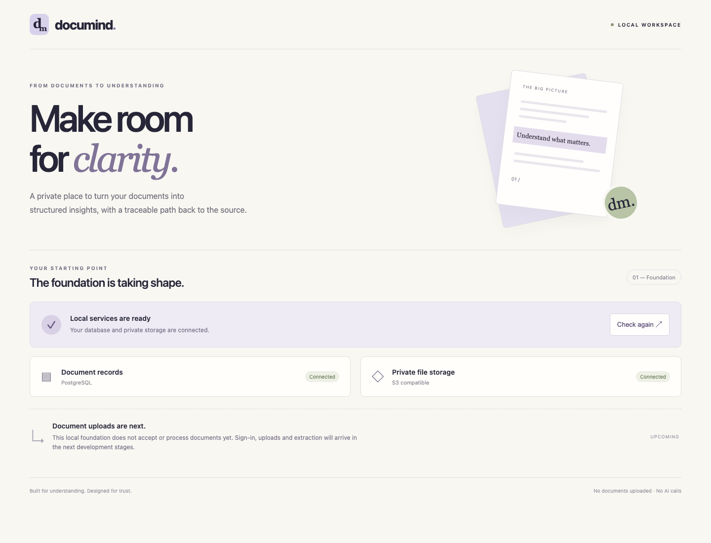

# DocuMind

A document-processing application demonstrating durable jobs, worker recovery and schema-validated AI extraction.

**Status:** DM-00 local foundation implemented, pending PR integration. The API, React readiness screen, private S3 storage and PostgreSQL run locally. User registration, document uploads, parsing, jobs and AI extraction are not implemented yet. No public deployment or paid provider is configured.



## Run locally

Requirements: **Go 1.27.3**, **Node 24.22.1**, Docker with Compose. Versions are recorded in `.go-version`, `.node-version`, `go.mod`/`go.sum` and `package-lock.json`.

```sh
npm ci
go mod download
npm run setup
npm run services:up
npm run db:migrate
```

In separate terminals, from the repository root:

```sh
npm run api
```

```sh
npm run dev
```

Open **http://127.0.0.1:4320**. The screen checks the API, PostgreSQL and an authenticated read of a synthetic object from the storage volume. If unavailable, start the services/API and use **Check again**. The frontend is a local development server; a production serving strategy belongs to deployment work.

The worker scaffold can validate its dependencies with `npm run worker:check`. `npm run worker` starts an explicitly idle process and shuts down on SIGINT/SIGTERM. It does not claim or process jobs yet.

## Local services and credentials

| Component | Loopback port | Purpose |
| --- | --- | --- |
| React/Vite | 4320 | Local UI, proxies `/api` to Go |
| Go API | 4321 | Liveness, readiness and denied protected routes |
| PostgreSQL 18 | 55433 | Separate bootstrap and restricted runtime roles |
| SeaweedFS 4.51 S3 | 58333 | Private `documind-local` bucket |

Ports are separate from TenantFlow. Compose uses digest-pinned images and persistent volumes; no host-directory mounts are required. Initial storage startup/recovery may take tens of seconds; `services:up` waits for volume registration. Memory limits: 512 MiB PostgreSQL and 768 MiB storage.

Setup generates `.env` with random credentials and restrictive file permissions; rerunning it preserves that file. Keep it with the existing volumes. Do not delete/regenerate credentials to restart services. The application uses bucket-scoped S3 credentials; separate initialization credentials create the bucket and the synthetic readiness object. The storage admin/filer interfaces are not published to the host. This is local HTTP development, not production TLS or a security certification.

`db:migrate` initializes the local runtime role if missing, applies checksum-guarded SQL migrations and initializes the private bucket/readiness object. It is repeatable and does not reset existing passwords. Document/job/result tables arrive in DM-01.

Stop services without deleting data:

```sh
npm run services:stop
```

After a restart, run `npm run services:up` to wait for health. Do not run `docker compose down -v` unless you explicitly intend to erase this local data.

## Verify

With services running and initialization complete:

```sh
npx playwright install chromium
npm run check
```

Stop the local API and Vite processes first: browser tests own ports 4320/4321. Checks run TypeScript, production web/Go builds, Go tests with the race detector, real PostgreSQL/S3 integration, the worker dependency check and four desktop/mobile browser scenarios. Tests use synthetic objects and clean up their own object keys. The UI error test injects a 503 response and then recovers against the real API; it is not a real service-outage simulation.

[Verification and limits](docs/verification.md) · [Bootstrap checkpoint](docs/checkpoints/2026-10-30-bootstrap.md)

## Engineering records

- [Approved MVP specification](specs/001-document-pipeline/spec.md)
- [DM-00 acceptance and integration boundaries](specs/001-document-pipeline/contracts/bootstrap.md)
- [Plan](specs/001-document-pipeline/plan.md) and [tasks](specs/001-document-pipeline/tasks.md)
- [Integration ADR](docs/adr/0002-integrations.md) and [durable-job ADR](docs/adr/0001-durable-job-table.md)
- [Constitution](.specify/memory/constitution.md), [governance](docs/governance.md), [Spec Kit](docs/spec-kit.md)
- [Release checklist](docs/release-checklist.md) and [issues](https://github.com/msalomonn/documind/issues)

Next: DM-01 implements real identity/session handling, owner-scoped upload and transactional document/job registration. Identity has no development bypass: `/api/me` and `/api/documents` return 401 until that implementation exists. PDF parser, fake extraction and live provider are later work; costs, retention and public hosting remain decisions before release.

The cross-project roadmap lives in [portfolio-engineering](https://github.com/msalomonn/portfolio-engineering). November 6 for a local MVP and November 13 for public release remain tentative targets.
